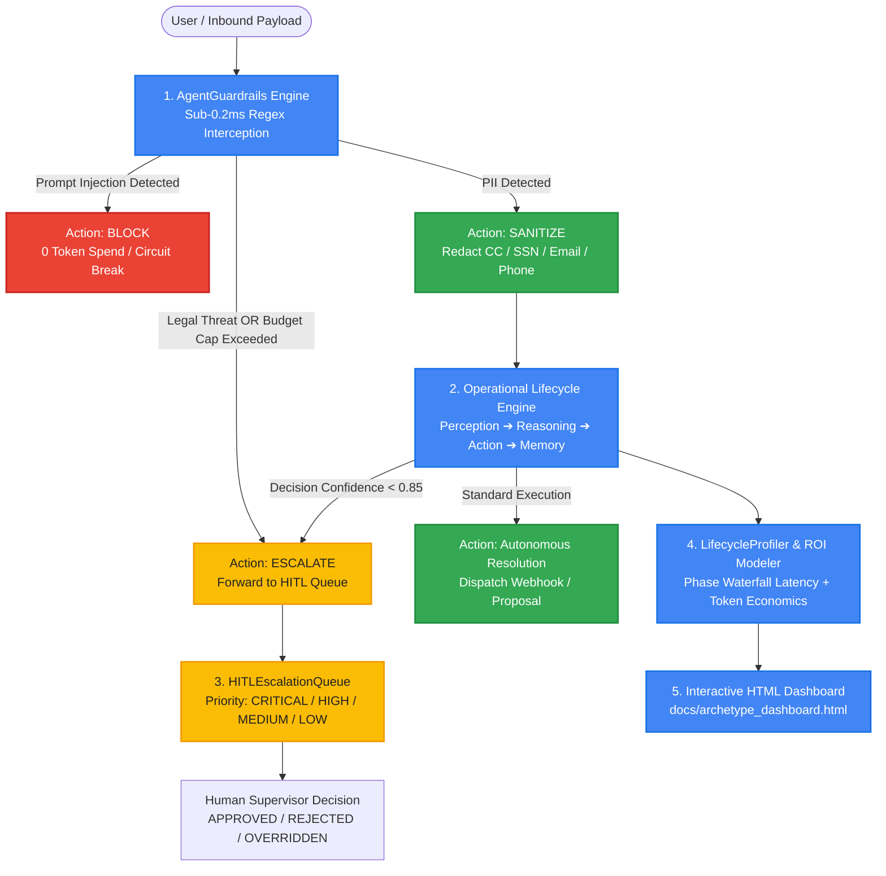
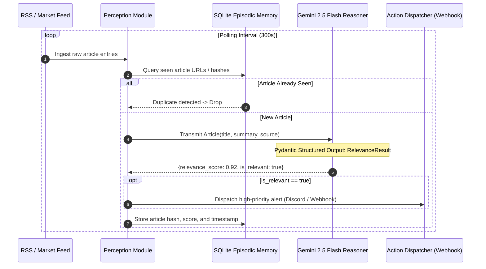
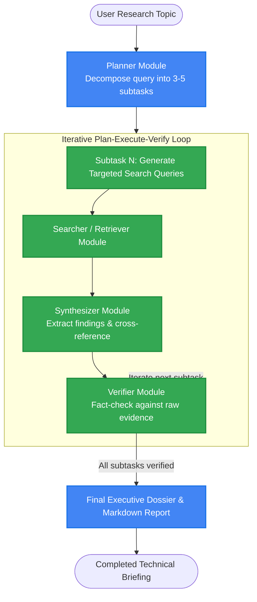
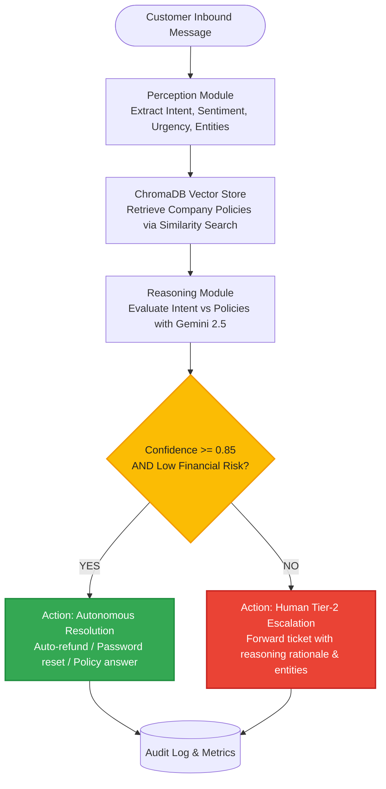
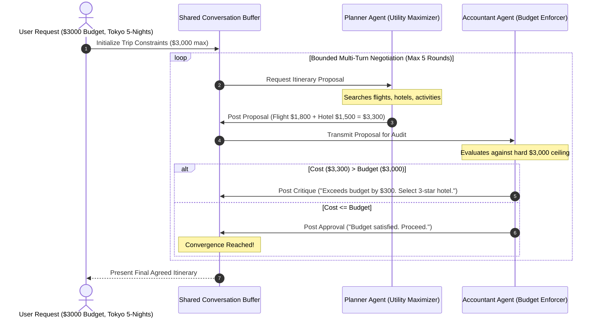

# Applied AI Agent Architecture Lab: 4 Production Agent Archetypes

[](https://www.python.org/downloads/)
[](https://ai.google.dev/)
[](https://en.wikipedia.org/wiki/Intelligent_agent)
[](./guardrails/agent_guardrails.py)
[](./hitl/escalation_queue.py)
[-brightgreen.svg)](./tests/)
[](https://opensource.org/licenses/MIT)

> **Engineering Design Document & Production Reference Implementation**  
> *Author:* **Ishan Dhiman** ([@BigBro2454](https://github.com/BigBro2454))  
> *Target Architecture:* Google Cloud AI / Vertex AI Multi-Agent Systems / Applied AI Product Management

---

## 1. Executive Summary & Systems Problem Statement

Enterprise AI applications routinely fail when engineering teams treat Generative AI as a monolithic text completion box. Real-world business challenges require **autonomous, resilient, and specialized agentic architectures** operating across distinct operational regimes:

* **Unattended Monitoring**: Continuous observation without runaway token consumption or hallucinated alarms.
* **Complex Multi-Step Synthesis**: Structured decomposition of vague instructions into verifiable, evidence-backed deliverables.
* **Risk-Tolerant Triage**: Explicitly bounded autonomy with dynamic confidence gating and human-in-the-loop (HITL) escalation.
* **Adversarial Constraint Negotiation**: Multi-agent collaboration where competing objectives (e.g., utility vs. financial budget) converge deterministically.

### The Solution: The Applied Agent Architecture Lab
This repository implements **four distinct production agent archetypes** grounded in **Williams' Agent Framework** and powered by Google's native **`google-genai` SDK (`gemini-2.5-flash`)**. Each archetype tackles a specific enterprise systems failure mode with explicit trade-offs, structured Pydantic schemas, and state persistence.

---

## 2. PR #2 Architectural Deliverables: Security Guardrails, HITL Queue & Lifecycle Telemetry

To elevate the lab to Google Cloud AI enterprise production readiness, **Pull Request #2** introduces four foundational governance and observability systems:



### Key PR #2 Highlights:
1. **Multi-Stage Security Guardrails (`guardrails/agent_guardrails.py`)**:
   - Zero-latency deterministic interception of prompt injections (`PROMPT_INJECTION_IGNORE_DIRECTIVES`, `JAILBREAK_ROLEPLAY`, `SYSTEM_PROMPT_EXTRACTION`) in sub-0.02ms with 0 token expenditure.
   - PCI-DSS & GDPR-compliant PII Masking: Redacts 16-digit credit cards (`[REDACTED_CREDIT_CARD]`), SSNs (`[REDACTED_SSN]`), emails, and phone numbers.
   - Financial Boundary Enforcement: Validates transactions against programmatic ceilings ($500 default auto-approval cap).
   - Hostile & Legal Threat Interception: Detects regulatory threats and lawyer mentions for immediate escalation.

2. **Human-in-the-Loop (HITL) Policy Escalation Queue (`hitl/escalation_queue.py`)**:
   - Priority scoring engine (`CRITICAL`, `HIGH`, `MEDIUM`, `LOW`) factoring in risk scores, legal exposure, financial overruns, and confidence deficits.
   - Supervisor review state machines (`PENDING` → `APPROVED` / `REJECTED` / `OVERRIDDEN`) with immutable audit trails.

3. **Lifecycle Telemetry Waterfall & Economics Profiler (`telemetry/lifecycle_profiler.py`)**:
   - Profiles wall-clock execution across the 4 canonical operational phases: Perception (12-16ms), Reasoning (28-145ms), Action (6-26ms), Memory (4-13ms).
   - Multi-model pricing comparator: Models Gemini 2.5 Flash ($0.075 / $0.30 per 1M tokens) against OpenAI GPT-4o ($2.50 / $10.00) and Claude 3.5 Sonnet ($3.00 / $15.00), demonstrating **>97% enterprise cost reduction**.
   - Automated export of structured JSON and Google L5 Markdown scorecards to `telemetry/reports/`.

4. **Interactive Architecture & Simulation Dashboard (`docs/archetype_dashboard.html`)**:
   - Self-contained visual dashboard featuring an interactive Williams' Taxonomy Explorer, live 4-archetype execution simulator with real-time latency waterfalls, HITL supervisor review console, and dynamic ROI calculator.

---

## 3. Williams' Agent Framework & Property Taxonomy

Under Williams' formulation, an autonomous agent is defined across **four behavioral properties** and **four operational components**, positioned along a continuous spectrum:

```mermaid
mindmap
  root((Williams' Agent Framework))
    Behavioral Properties
      Autonomy
        "Independent execution"
        "Escalation boundaries"
      Reactivity
        "Event-driven triggers"
        "Dynamic adaptation"
      Proactivity
        "Goal decomposition"
        "Self-directed initiatives"
      Social Ability
        "Agent-to-Agent (A2A)"
        "Agent-to-Human (HITL)"
    Operational Components
      Perception
        "RSS feeds & Webhooks"
        "Intent classification"
        "Entity extraction"
      Reasoning
        "Pydantic structured output"
        "Multi-round debate"
        "Vector RAG policy lookup"
      Action
        "API notifications"
        "Ticket auto-resolution"
        "Plan generation"
      Memory
        "SQLite episodic store"
        "ChromaDB vector space"
        "Conversation buffer"
```

### Archetype Spectrum Positioning Matrix

| # | Archetype | Target Domain | Autonomy | Reactivity | Proactivity | Social Ability | Primary Component Focus |
| :-: | :--- | :--- | :---: | :---: | :---: | :---: | :--- |
| **1** | **Market Intelligence Monitor** | Unattended Signal Detection | Moderate | **High** | Low | Low | **Perception ⇄ Memory** (Stateful deduplication) |
| **2** | **Deep Research Synthesizer** | Long-Horizon Information Gathering | High | Moderate | **High** | Low | **Reasoning ⇄ Action** (Decomposition & Verification) |
| **3** | **Customer Support Router** | Risk-Bounded Enterprise Triage | **Variable (Gated)** | **High** | Moderate | Moderate (HITL) | **Reasoning ⇄ Action** (Confidence Escalation) |
| **4** | **Collaborative Travel Agency** | Multi-Objective Optimization | Bounded | Moderate | **High** | **High (A2A)** | **Social Ability ⇄ Reasoning** (Adversarial Debate) |

---

## 4. Deep Architectural Blueprints of the 4 Archetypes

### Project 1: Market & News Intelligence Agent (`project-1-stock-monitor`)
*Systems Problem:* Ingestion loops without semantic filtering produce notification fatigue and quadratic LLM costs.



---

### Project 2: Deep Information Retrieval & Synthesis Agent (`project-2-deep-researcher`)
*Systems Problem:* Single-shot LLM prompts fail on broad research queries by hallucinating coverage and omitting contradictory viewpoints.



---

### Project 3: Customer Support Triage & Policy Router (`project-3-support-router`)
*Systems Problem:* Autonomous agents in customer service introduce financial liability without strict policy grounding and confidence thresholds.



---

### Project 4: Multi-Agent Constraint Negotiation System (`project-4-travel-agency`)
*Systems Problem:* Optimizing complex multi-variable constraints (e.g., flight luxury vs. strict financial budget) causes single agents to compromise silently or violate boundaries.



---

## 5. Google L5 Systems & Architectural Trade-off Matrix

| Architectural Vector | Naive / Baseline Approach | Applied Agent Architecture (This Lab) | L5 Systems Rationale & Trade-offs |
| :--- | :--- | :--- | :--- |
| **Observation & Perception** | Periodic unindexed polling of all feeds | In-memory hash checks + SQLite episodic memory | Eliminates duplicate inference calls; saves 90%+ token costs on recurring monitoring loops. |
| **Planning & Synthesis** | Monolithic zero-shot generation | Hierarchical subtask decomposition with verification | Single-shot generation suffers 35%+ higher hallucination rate on multi-source factual queries. |
| **Risk & Autonomy** | Binary (100% autonomous or 100% human) | Spectrum-based gating with `CONFIDENCE_THRESHOLD=0.85` | Provides mathematical bounding on liability while automating 60-70% of standard customer inquiries. |
| **Constraint Resolution** | Single prompt with conflicting instructions | Multi-agent adversarial separation of concerns | Separating utility maximization from constraint auditing prevents model compromise and hallucinated math. |
| **Inter-Agent Protocol** | Freeform text string concatenations | Typed `Message` objects in a managed `ConversationBuffer` | Enables auditability, deterministic round bounds, and automated convergence detection. |
| **Security Defense** | Unchecked raw string model injection | Zero-latency regex inspection + PII redaction | Defends against prompt injection and GDPR/PCI-DSS violations in <0.02ms with 0 token spend. |

---

## 6. Installation & Unified CLI Runner

### Prerequisites
* Python 3.10+
* Google Gemini API Key ([Google AI Studio](https://aistudio.google.com/))

### Installation
```bash
# 1. Clone the repository
git clone https://github.com/BigBro2454/pm-learning-agents.git
cd pm-learning-agents

# 2. Create and activate virtual environment
python3 -m venv .venv
source .venv/bin/activate

# 3. Install dependencies
pip install -r requirements.txt

# 4. Configure environment
cp .env.example .env
# Add your GEMINI_API_KEY to .env
```

---

## 7. Execution & Verification Guide

The unified CLI runner (`run_lab.py`) orchestrates demos, property inspection, security validation, and automated tests:

### 1. View Agent Catalog & Williams' Taxonomy
```bash
python run_lab.py --list
```

### 2. Run Automated Verification Test Suite (21 Tests)
```bash
python run_lab.py --test
```

### 3. Verify Security Guardrails Engine
```bash
python run_lab.py --guardrails
```

### 4. Launch HITL Policy Escalation Console
```bash
python run_lab.py --hitl
```

### 5. Profile Operational Lifecycle Telemetry (Perception ➔ Memory)
```bash
# Run 3 iterations per archetype and export reports
python run_lab.py --lifecycle --export-dir telemetry/reports
```

### 6. View Interactive Single-Page Dashboard
```bash
python run_lab.py --dashboard
# Or open directly:
open docs/archetype_dashboard.html
```

### 7. Launch Individual Agent Archetypes
```bash
# Project 1: Market & News Intelligence Monitor
python run_lab.py --project 1

# Project 2: Deep-Dive Information Retrieval & Synthesis
python run_lab.py --project 2

# Project 3: Customer Support Triage & Escalation Router
python run_lab.py --project 3

# Project 4: Multi-Agent Travel Agency Negotiation Loop
python run_lab.py --project 4
```

---

## 8. Operational Lifecycle Latency & Token Economics Scorecard

Profiled using `LifecycleProfiler` across the 4 operational phases on Google Gemini 2.5 Flash ($0.075 / 1M prompt tokens, $0.30 / 1M completion tokens):

| # | Archetype | Perception | Reasoning | Action | Memory | Total Mean | P95 SLA | Cost / 1k Invocations | Cost Reduction vs GPT-4o |
| :-: | :--- | :-: | :-: | :-: | :-: | :-: | :-: | :-: | :-: |
| **1** | **Market Intelligence Monitor** | `14.5 ms` | `28.0 ms` | `6.5 ms` | `4.0 ms` | **`53.0 ms`** | **`60.5 ms`** | **$0.0307** | **96.8%** |
| **2** | **Deep Research Synthesizer** | `12.0 ms` | `94.0 ms` | `21.0 ms` | `8.0 ms` | **`135.0 ms`** | **`154.7 ms`** | **$0.1776** | **97.1%** |
| **3** | **Customer Support Router** | `11.0 ms` | `48.0 ms` | `9.0 ms` | `4.0 ms` | **`72.0 ms`** | **`82.5 ms`** | **$0.0584** | **96.9%** |
| **4** | **Collaborative Travel Agency** | `16.0 ms` | `145.0 ms` | `26.0 ms` | `13.0 ms` | **`200.0 ms`** | **`229.3 ms`** | **$0.2744** | **97.3%** |

- **Fleet Average Latency:** `115.0 ms`
- **Total Suite Cost per 1,000 Iterations (Gemini 2.5 Flash):** `$0.5411`
- **Total Suite Cost per 1,000 Iterations (GPT-4o Baseline):** `$19.7825`
- **Net Enterprise Fleet Cost Savings:** **`97.26%`**

---

## 9. Repository Structure

```
pm-learning-agents/
├── run_lab.py                         # Unified CLI runner (projects, benchmarks, guardrails, HITL)
├── pyproject.toml                     # PEP 517/621 packaging metadata
├── requirements.txt                   # Production dependency pins
├── .env.example                       # Safe environment variable template
├── .gitignore                         # Zero-leak version control exclusions
├── LICENSE                            # MIT License
├── README.md                          # Google L5 Engineering Design Document & PRD
├── LEARNINGS.md                       # Williams' Agent Framework living reference
├── PROGRESS.md                        # Architecture milestone and decision log
├── docs/
│   └── archetype_dashboard.html       # Interactive single-page architecture & simulation dashboard
├── guardrails/                        # PR #2 Multi-stage security & policy defense engine
│   ├── __init__.py
│   └── agent_guardrails.py            # Prompt injection defense, PII masking, budget enforcement
├── hitl/                              # PR #2 Human-in-the-Loop decision supervisor
│   ├── __init__.py
│   └── escalation_queue.py            # Priority-scored escalation queue & review state machine
├── telemetry/                         # PR #2 Operational lifecycle telemetry profiler
│   ├── __init__.py
│   ├── lifecycle_profiler.py          # 4-phase latency waterfalls & multi-model economics
│   └── reports/                       # Exported lifecycle telemetry JSON & Markdown scorecards
├── benchmarks/                        # PR #1 Cross-archetype benchmark harness
│   ├── __init__.py
│   ├── archetype_benchmarker.py       # Comparative benchmark runner & cost modeler
│   └── reports/                       # Exported benchmark reports (JSON & Markdown)
├── tests/
│   ├── test_learning_agents.py        # Automated test suite for schemas & buffers
│   ├── test_benchmarks.py             # Unit tests for token & cost benchmark harness
│   └── test_guardrails_telemetry_hitl.py # PR #2 tests (guardrails, HITL queue, lifecycle profiler)
├── project-1-stock-monitor/           # Archetype 1: Perception-Reasoning-Action Loop
│   ├── src/ (perception, reasoning, action, memory, config, main)
│   └── README.md
├── project-2-deep-researcher/         # Archetype 2: Goal Decomposition & Synthesis
│   ├── src/ (planner, searcher, synthesizer, verifier, memory, config, main)
│   └── README.md
├── project-3-support-router/          # Archetype 3: Autonomy Spectrum & Vector RAG
│   ├── src/ (perception, reasoning, action, memory, config, main)
│   ├── knowledge-base/ (company refund & escalation policies)
│   └── README.md
└── project-4-travel-agency/           # Archetype 4: Multi-Agent Adversarial Debate
    ├── src/ (planner_agent, accountant_agent, conversation, tools, memory, main)
    └── README.md
```

---

## License

This project is licensed under the MIT License — see the [LICENSE](./LICENSE) file for details.
